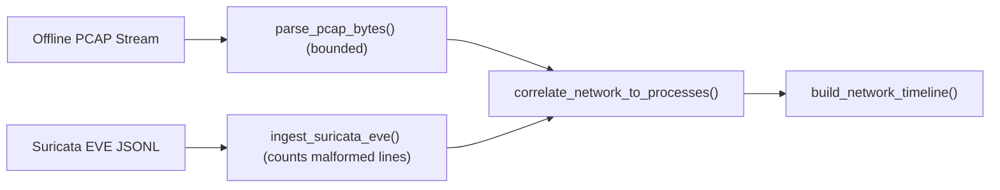

# Ghostwire Network Defense Lab

**Passive offline PCAP parser, Suricata EVE JSON ingestion, DNS entropy heuristics, and host process correlation.**

## Problem Statement

Unbounded packet and log parsers risk memory exhaustion or crashes on malformed captures, while raw network alerts lack host process context. `ghostwire-network-defense-lab` provides bounded, purely passive offline network ingestion normalized to a versioned `SecurityEvent` schema.

## Architecture



## Reproducible Setup & Verification

```bash
git clone https://github.com/Bboy9090/ghostwire-network-defense-lab.git
cd ghostwire-network-defense-lab
python3 -m unittest discover -s tests -v
```

## Security & Authorization Boundaries

- Strictly passive offline analysis of PCAP/EVE files; performs no active network scanning or traffic blocking.
- Enforces `max_bytes`, `max_packets`, and `max_lines` bounds against malformed or truncated inputs.

## Limitations

- PCAP parser decodes Ethernet + IPv4 + TCP/UDP headers (IPv6 and VLAN-tagged frames are skipped safely).
- Shannon entropy DNS checks (`is_suspicious_dns_domain`) are heuristic signals, not definitive proof of DGA malware.

## Case Study

1. **Problem:** Need safe offline PCAP & Suricata EVE correlation without C-extension dependencies.
2. **Engineering Solution:** Implemented bounded pure-Python `struct` PCAP parsing, EVE JSONL ingestion, and `(local_port, remote_ip, remote_port)` socket-to-PID correlation.
3. **Results:** `4/4` unit tests pass, rejecting malformed PCAPs cleanly and counting malformed EVE JSON lines without aborting valid ingestion.
